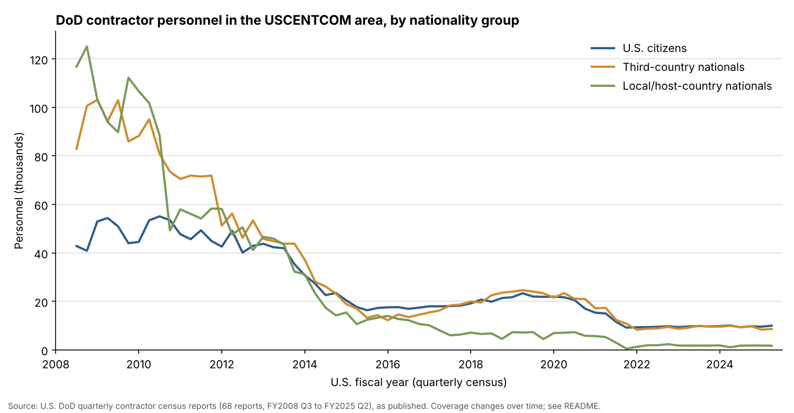

# contractor-census

[](https://doi.org/10.5281/zenodo.23736050)

A cleaned, checked archive of the U.S. Department of Defense's quarterly contractor census for the U.S. Central Command (USCENTCOM) area: how many contractor personnel worked for the DoD in Iraq, Afghanistan, Syria and the rest of the region, and whether they were U.S. citizens, third-country nationals or local nationals.

The Pentagon published these reports every quarter from 2008 to 2025. The April 2025 report states that it is the final one, so this archive is complete: **68 reports, from the 3rd quarter of fiscal year 2008 to the 2nd quarter of fiscal year 2025.**

## What this is and why it matters

When the U.S. military operates abroad, much of the work behind it is done by private companies: cooking, driving, building, maintenance and security. For 17 years the Pentagon counted these workers every three months and recorded whether they were Americans, local nationals, or workers brought in from other countries. At the peak, in 2008, there were about 266,700 of them; by 2025 there were about 20,400.

The Pentagon has stopped publishing the count, and the reports existed only as 68 separate PDF files. This repository puts the full series into one checked table, and flags three reports whose printed numbers do not add up. It can be used to compare the use of contractors with troop levels over time, to follow how many workers came from third countries, to check official statements about the size of the U.S. presence, and as a permanent, citable record of a series that no longer exists.



## The data

[`data/clean/contractor_census_headcounts.csv`](data/clean/contractor_census_headcounts.csv), one row per area per report (251 rows).

| Column | Meaning |
|---|---|
| `report_file` | The source PDF in `data/raw/` |
| `fiscal_year`, `fiscal_quarter` | The U.S. fiscal year and quarter the count covers (the fiscal year starts on 1 October) |
| `published` | Month the report was published, from its file name |
| `area` | Standard area name: `Afghanistan`, `Iraq`, `Iraq and Syria`, `Other USCENTCOM locations`, `USCENTCOM AOR total` |
| `label_in_report` | The row label exactly as printed, including footnote marks |
| `total` | Total contractor personnel |
| `us_citizens` | U.S. citizens |
| `third_country_nationals` | Citizens of neither the U.S. nor the host country |
| `local_nationals` | Local or host-country nationals |
| `note` | Explanation where the printed numbers have a known problem (see below) |

Numbers are kept **exactly as printed**. Nothing has been corrected, estimated or filled in.

## Things to know before comparing numbers over time

- **Coverage changes.** Afghanistan appears through FY2021 Q4. Iraq is reported alone through FY2018 Q1, then as "Iraq and Syria" from FY2018 Q2. The reports say Israel is included in the USCENTCOM totals from FY2021 Q4.
- **No "other locations" row in the first two reports** (FY2008 Q3 and Q4). Their USCENTCOM totals include other locations, but those locations are not shown separately.
- **FY2010 Q4 is a recount.** The report says a first count of 194,405 looked wrong for Afghanistan and was redone, giving 176,340. The dataset uses the recount, as printed in the table.
- **Only DoD contracts.** The reports state that contractors of other U.S. agencies are not included.

## Printing errors in the original reports

Three reports contain tables whose numbers do not add up. Each one was confirmed by looking at an image of the printed page, so they are errors in the reports, not in this dataset. They are kept as printed and flagged in the `note` column.

| Report | Problem as printed |
|---|---|
| FY2009 Q3 | Afghanistan row: the parts add up to 72,968, not 73,968. The local-national column adds up to 88,793, not the printed total of 89,793. |
| FY2015 Q3 | Other locations and the USCENTCOM total: the parts add up to 56 more than the printed totals. |
| FY2017 Q1 | Other locations and the USCENTCOM total: the parts add up to 2,000 less than the printed totals. |

## How the numbers were checked

Run by [`code/02_check_headcounts.py`](code/02_check_headcounts.py); results in [`data/clean/check_report.md`](data/clean/check_report.md).

1. Every table was read twice with two different PDF readers (pdfplumber and Poppler's pdftotext). Both readings match exactly for all 251 rows.
2. Every row was checked to add up (total = U.S. + third-country + local).
3. Every report's areas were checked to add up to its own USCENTCOM total.
4. Each total was compared with the figure in the report's own summary text.
5. The fiscal quarter in each file name was compared with the quarter named in the report.
6. Quarter-to-quarter jumps were screened for possible misreadings.

Every problem these checks found is either confirmed against the printed page or explained above.

## Reproduce it

Needs Python 3 and Poppler (`pdftotext`).

```
pip install -r requirements.txt
python code/01_extract_headcounts.py
python code/02_check_headcounts.py
python code/03_make_figure.py
```

## Folders

| Folder | Contents |
|---|---|
| `data/raw/` | The 68 original report PDFs, unchanged |
| `data/clean/` | The clean dataset, the two separate readings, and the check report |
| `code/` | Numbered scripts, run in order |
| `figures/` | Chart made from the clean data |

## Sources and license

Sources and download details are in [`data/README.md`](data/README.md). Code: MIT (see [`LICENSE`](LICENSE)). The clean dataset: CC BY 4.0. The original reports are U.S. government works.

## Cite

Azom, Kazi Affnann (2026). *contractor-census: U.S. DoD quarterly contractor census for the USCENTCOM area, FY2008-FY2025* (Version v1.0.0) [Data set]. Zenodo. https://doi.org/10.5281/zenodo.23736051

- This version (v1.0.0): [10.5281/zenodo.23736051](https://doi.org/10.5281/zenodo.23736051)
- All versions (always points to the latest): [10.5281/zenodo.23736050](https://doi.org/10.5281/zenodo.23736050)

See also [`CITATION.cff`](CITATION.cff).
